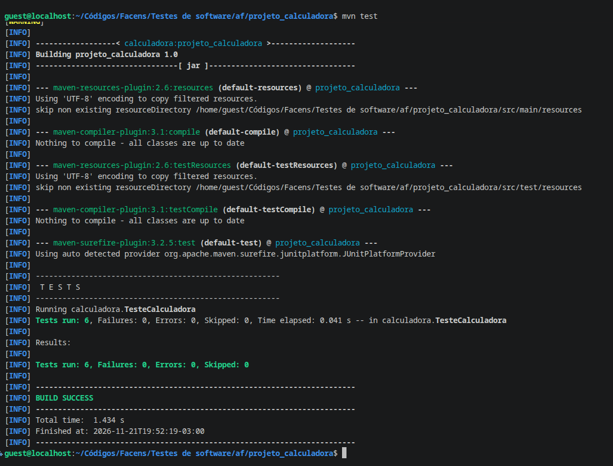
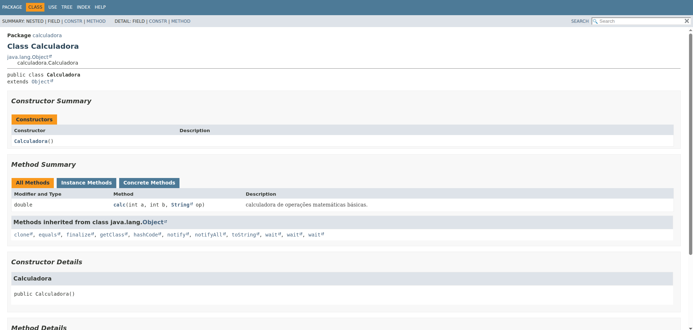

# Projeto Calculadora

## 1. Descrição

Este projeto consiste no desenvolvimento de uma calculadora matemática básica em Java, simulando um módulo de cálculos.

O projeto foi desenvolvido como parte de uma atividade acadêmica voltada à aplicação de práticas de qualidade de software.

## 2. Objetivo

Aplicar conceitos de desenvolvimento, validação, manutenção e documentação de software, utilizando testes unitários, tratamento de erros, refatoração, JavaDoc e versionamento.

## 3. Tecnologias utilizadas

- Java 17
- Maven
- JUnit 5
- Git
- GitHub
- JavaDoc

## 4. Funcionalidades

A calculadora realiza as seguintes operações matemáticas:

- Soma `+`
- Subtração `-` 
- Multiplicação `*`
- Divisão `/`

O sistema também trata operações inválidas e tentativas de divisão por zero.

## 5. Testes unitários

Foram desenvolvidos testes utilizando JUnit 5 para verificar o funcionamento das operações matemáticas e o tratamento de erros.

Os testes contemplam:

- Soma;
- Subtração;
- Multiplicação;
- Divisão;
- Divisão por zero;
- Operação inválida.

### Resultado dos testes



## 6. Refatoração

A refatoração foi realizada na branch `Refatoracao`, buscando melhorar a organização e a legibilidade do código sem alterar o comportamento funcional da calculadora.

A validação da divisão por zero foi separada em um método privado chamado validarDivisor(), isolando essa responsabilidade e tornando o método principal calc() mais organizado e legível.

Após as alterações, os testes unitários foram executados novamente para verificar a manutenção do funcionamento esperado.

## 7. Documentação JavaDoc

A documentação técnica foi desenvolvida utilizando JavaDoc, contemplando a descrição da classe, métodos, parâmetros, retornos e exceções.

A documentação HTML gerada está disponível na pasta `docs/`.

### Visualização da documentação



## 8. Estrutura do projeto

```text
projeto_calculadora/
├── src/
│   ├── main/java/calculadora/
│   │   └── Calculadora.java
│   └── test/java/calculadora/
│       └── TesteCalculadora.java
├── docs/
├── screenshots/
├── pom.xml
├── README.md
└── .gitignore
```

## 9. Repositório
https://github.com/Gap1748/projeto_calculadora
